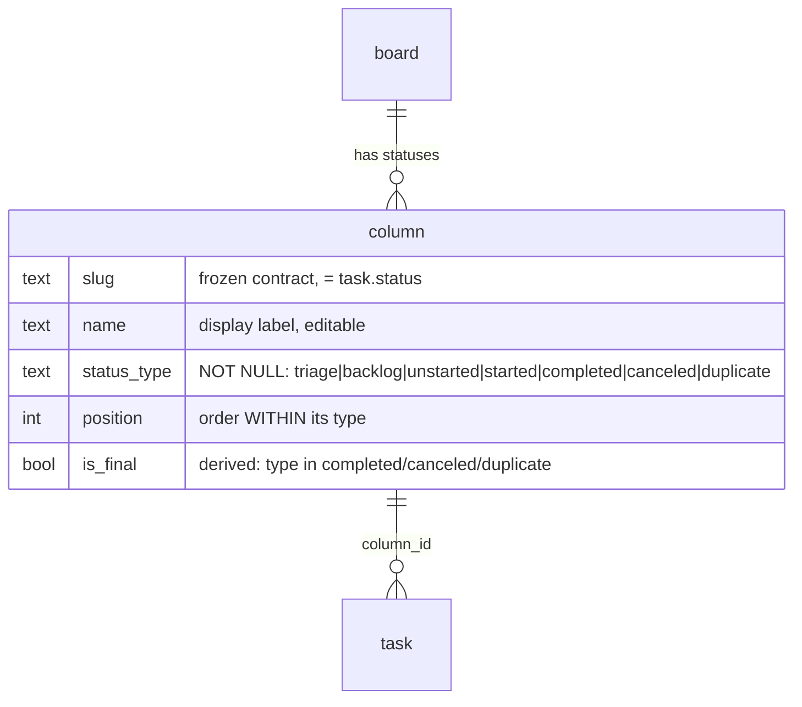

# Ticket status model — every status is a board row

Status: proposed 2026-11-14. Supersedes the split model left by #226 + PR #53.

## Problem (measured on kaneo.entelechia.cloud, 13 boards)

Two status systems coexist:

| System | Statuses | Editable | Typed | In Status settings |
|---|---|---|---|---|
| `column` rows | To Do, In Progress, In Review, Done, Canceled | yes | yes (`status_type`, nullable) | yes |
| hardcoded "virtual" (`status-taxonomy.ts`, `task-statuses.ts`) | Planned, Triage, Duplicate | no | implied | **no** |

Consequences found in code + data:

- **19 Planned tickets have `column_id = NULL`** — no row backs them; only the Backlog page's hardcoded `plannedTasks` shows them.
- **Triage tickets render nowhere**: API returns `triageTasks`, zero web consumers.
- Backlog/Triage/Duplicate cannot be renamed, re-typed, or added to ("no way to add a custom Status").
- Status type has a `None` option and 36 of 39 rows are untyped.
- History sealing (`update-task-status.ts`) keys off hardcoded closed slugs, so a custom closed status ("Won't fix") never seals.
- Pickers = board rows + a hardcoded tail filtered against a *hardcoded* default list — a board that renames or deletes a lane gets duplicates or holes.

## Model

One rule: **a status is a `column` row; its `status_type` decides where it appears and how it behaves.** No hardcoded statuses remain.

| Type | Surface | Closed (`is_final`) | Default seeded row |
|---|---|---|---|
| triage | Backlog page, top section | no | Triage (`triage`) |
| backlog | Backlog page section | no | Planned (`planned`) |
| unstarted | Board lane | no | To Do (`to-do`) |
| started | Board lane | no | In Progress (`in-progress`), In Review (`in-review`) |
| completed | Board lane | yes | Done (`done`) |
| canceled | Board lane | yes | Canceled (`canceled`) |
| duplicate | Board lane | yes | Duplicate (`duplicate`) |

Order everywhere (board, pickers, settings, backlog sections) = `(type rank, position)`. Type rank is the table order. Archive stays orthogonal (`archived_at`) and keeps its own section/action.

Labels are unchanged (owner direction): the backlog-type default is still labelled "Planned"; it is renamable per board now that it is a row.

## Invariants

1. `status_type` NOT NULL — the `None` option goes away. API rejects null/unknown type with 400 (never a raw CHECK 500); `isFinal:false` on update is no longer a "clear type" path.
2. `is_final` = closed type, maintained by create/update (already true for update).
3. A board always keeps ≥1 status of each type: deleting **or re-typing** the last one → 409.
4. Valid `task.status` = the board's row slugs. Nothing else. Every hardcoded fallback goes through one helper, `resolveStatusByType(boardId, type)` (seeded slug if present, else first row of that type).
5. `task.column_id` always set (backfilled).
6. `UNIQUE(board_id, slug)` in the DB — today it's app-level only, and one duplicate row double-renders tickets.
7. Lane order is type-locked: settings drag reorders **within** a type group only; changing type is an explicit action.
8. "Closed" anywhere = the target row's `is_final`, never a slug list.

## Changes

**Migration 0084** (idempotent, per board):
- insert missing `triage` / `planned` / `duplicate` rows (and `canceled` if 0083 skipped it);
- backfill `status_type` from slug map; unknown custom slugs → `completed` if `is_final` else `started`;
- `status_type` NOT NULL + CHECK in the 7 values;
- `is_final = type in closed`;
- `UNIQUE(board_id, slug)` (live data verified clean);
- backfill `task.column_id` by slug.

**API**
- `create-board` / `column-migration`: seed all 8 rows.
- `get-columns` and `get-tasks`: order by type rank, position.
- `get-tasks`: `columns` = board-surface rows (unstarted…duplicate); new `backlogColumns` = triage+backlog rows with tasks; `plannedTasks` kept as their flat concatenation for the ~14 consumers that only want "all backlog tickets"; drop the dead `triageTasks`.
- `get-tasks`: `plannedTasks` concat keeps today's archived exclusion and pagination. Drop `triageTasks` stub in `get-boards.ts` too.
- `validate-task-fields`: board rows only. `create-column`: drop the reserved-slug 409, take `statusType` (required, 400 on null). `update-column`: no null type; last-of-type guard on re-type. `delete-column`: last-of-type guard. `reorder-columns`: positions within a type.
- `resolveStatusByType` callers (all six hardcoded fallbacks): `coerceStatus` → backlog (`validate-task-fields.ts`, used by `import-tasks`); create default → unstarted (`create-task.ts`); forge close fallbacks → completed (github `issue-closed.ts` ×2, `pull-request-closed.ts`; gitea `issue-closed.ts`, `pull-request-closed.ts`); Move to Backlog → backlog.
- Closed detection by row `is_final`: `update-task-status.ts` (history seal), github `task-service.ts`, github + gitea `events/task-status-changed.ts`.
- `status-taxonomy.ts`: keep type constants + slug→type map (migration/seed source); delete `NON_COLUMN_*`, `BACKLOG_STATUS_SLUGS`, `CLOSED_STATUS_SLUGS`, `isClosedStatus`, unused `applyStatusOrder`, stale "In Review no longer seeded" comment.

**Web**
- Status settings: rows grouped under type headers, "+ Add status" per type group (= custom statuses), type Select without `None`.
- Pickers (task popover, subtask popover, card context menu, bulk bar): the board's rows, grouped by type, then Archive section. `NON_COLUMN_STATUS_DEFINITIONS` deleted.
- Backlog page: one section per `backlogColumns` row (Triage, Planned, custom…), then Archived. Dropping into a section sets that row's slug. `BacklogSection` in `lib/task-archival.ts` becomes `<row slug> | "archived"`; hard-coded `"planned"` section ids in `backlog-list-view/index.tsx` go per-row.
- Status settings drag: within a type group only.
- "Move to Backlog" (bulk, context menu, command palette): first backlog-type row.

## Review

Adversarial review (glm-flash, 2026-11-14): APPROVE-WITH-CHANGES. All 10 findings folded in above — unique slug constraint, re-type guard, `resolveStatusByType` at six fallback sites, `is_final` closed detection in forge events, type-locked lane order, 400 on null type, backlog section plumbing, `plannedTasks` parity, two nits. Alternative considered and rejected by both: a separate per-board status table for triage/backlog/duplicate reimplements slug/position/is_final and leaves two ordering systems.

## Not doing

- `task_status_order` / `backlog_status_order` board jsonb: superseded by row position; left in place, unread by the new surfaces. Drop in a later cleanup migration.
- Hiding closed lanes on the board: add a view toggle when 6 lanes proves too wide.
- Changing labels.
