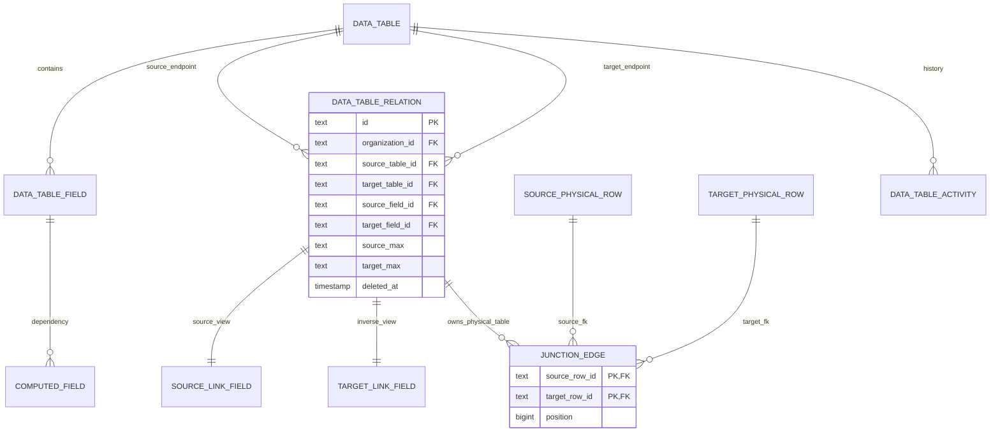
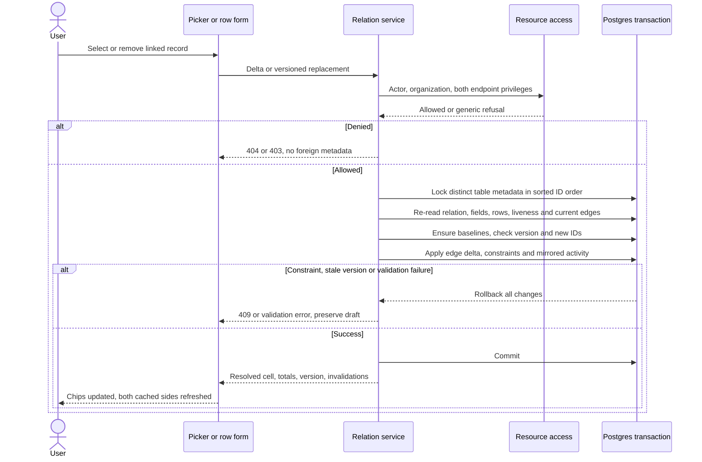
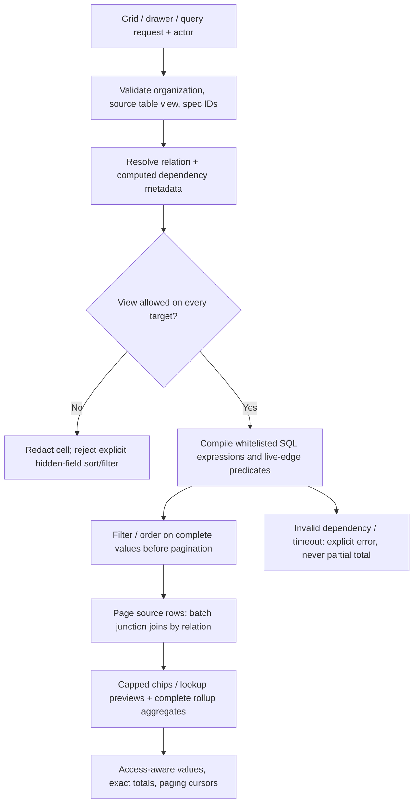
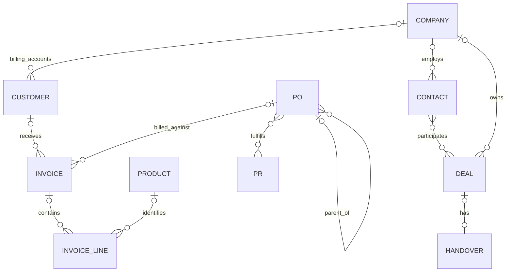

# Kaneo Tables: cross-table relations

Document ID: KANEO-TABLE-RELATIONS · revision 1 · 2026-11-17 (WIB)

Status: **Draft design for implementation review; not implemented or approved for release.**

Owner / approval: Kaneo product owner · author: Terminus, design sub-agent. Independent review belongs to the parent workstream; not performed by another agent in this task.

Audience: API, web and database implementers. Allowed use: estimate, review and sequence implementation; no database change is authorized by this document.

Baseline: `fix/table-search-toolbar`, commit `cc09fe5684aed5cdf943ee00938f42b86779b00c`. PR [#68](https://github.com/IEatCodeDaily/kaneo/pull/68), typed New row form, was **OPEN / unmerged** when checked on 2026-11-17; it is not part of this baseline.

Retention: repository history and draft PR are the authoritative design record; retain while implemented behavior depends on it. Product owner owns supersession/disposition, subject to organizational retention rules and holds. Re-review when permissions, trash semantics, primary-field identity or the query contract changes.

## 1. Recommendation and boundary

Use **one physical junction table per relation**, two paired `link` fields, and read-time SQL for `lookup` and `rollup`. One relationship has one authoritative edge set: updating either field updates the same rows, not a second JSON array. Use native PostgreSQL foreign keys and unique constraints, the existing resource privilege lattice, runtime DDL ledger, grid cell components and row drawer. No new dependencies, graph database, workflow engine, materialized-value worker or formula language.

This enables invoice lines belonging to an invoice and product, customers with invoices and contacts, purchase orders (PO) linked to purchase requests (PR), and CRM companies/contacts/deals. It does **not** make Tables an accounting ledger: approvals, immutable issued invoices, tax calculations, exchange rates, payments and workflow automation remain separate product work. A lookup is live data, not an invoice-address or price snapshot.

All statements below are **proposed defaults**, except the source observations in §2. Limits and estimates are design targets, not measured performance. This document supersedes only the deferred relation sketch in [table-feature-discovery.md §9](table-feature-discovery.md#9-pivot-owner-decision-nocodb-style-typed-tables--grafana-style-dashboards), not the settled same-Postgres storage decision. Earlier ticket-table-only recommendations in that file were superseded by its own §9 pivot.

### Glossary

- **Relation:** one directed pair of table endpoints and its single edge set.
- **Endpoint / paired field:** one table's view of that relation. “Source” and “target” are fixed creation-time roles, not the side currently being edited.
- **Edge:** a `(source row, target row)` association; inverse fields view the same edge backwards.
- **Primary field:** currently the first field ordered by `(position, id)`; its resolved display value labels a record. It is not the row's identity or a guaranteed unique key.
- **Lookup:** read-only values from one field of linked records.
- **Rollup:** read-only aggregate over those linked records.
- **Active edge:** retained edge whose relation, endpoint fields, endpoint tables and both endpoint rows are live. Trash can retain an edge without making it active.

## 2. Source-grounded starting point

| Verified observation | Source at the pinned baseline | Required change |
|---|---|---|
| `link` is registered, stored as JSONB, accepts deduplicated string arrays, and has only `options.targetTableId`. There is no target-row or target-table ownership validation for it. | [fields.ts:4–48](../apps/api/src/data-table/fields.ts#L4), [118–120](../apps/api/src/data-table/fields.ts#L118), [261–279](../apps/api/src/data-table/fields.ts#L261); [controllers.ts:905–957](../apps/api/src/data-table/controllers.ts#L905) | Migrate, then route every link write through shared relation validation. UI-disabled does not mean the API has never stored data. |
| Row tables are `kaneo_tables.t_<tableId>`, columns `c_<fieldId>`, IDs are **text cuids**, not UUIDs. DDL validates alphanumeric metadata IDs, logs statements, and runs in the caller's transaction. | [store.ts:78–119](../apps/api/src/data-table/store.ts#L78), [147–186](../apps/api/src/data-table/store.ts#L147) | Reuse the naming/quoting boundary for `l_<relationId>`. Do not interpolate names or client SQL. |
| Tables have soft delete; physical rows do **not**. `deleteRow` executes SQL `DELETE`; field deletion drops the column and metadata. The existing revert endpoint restores only a type conversion, not arbitrary deleted rows/fields. | [schema.ts:807–867](../apps/api/src/database/schema.ts#L807), [store.ts:155–165](../apps/api/src/data-table/store.ts#L155), [561–569](../apps/api/src/data-table/store.ts#L561), [controllers.ts:362–474](../apps/api/src/data-table/controllers.ts#L362), [1045–1082](../apps/api/src/data-table/controllers.ts#L1045) | Row trash and paired-field trash are explicit Phase 1 additions, not capabilities to assume already exist. |
| `mutateTable` locks one metadata table row, ensures a complete history baseline, then writes on one transaction connection. | [controllers.ts:109–209](../apps/api/src/data-table/controllers.ts#L109) | Extend this discipline to ordered multi-table locks; do not nest source-first single-table writers. |
| Reads need `view`; row/cell/field changes need `edit`; table rename/delete/purge/restore need `manage`. Hidden tables return 404. Grants resolve through existing user/team/org rules. | [index.ts:94–118](../apps/api/src/data-table/index.ts#L94), [resource-access.ts:87–170](../apps/api/src/resource-access.ts#L87) | Check **each** relation endpoint, not only the route's `tableId`. Keep existence/org validation separate from privilege resolution. |
| Ticket validation checks new task IDs against the organization and live tasks, while allowing already-stored stale IDs to survive an unrelated full-array update. Picker options intersect accessible boards; page reads batch ticket references. Reverse ticket reads additionally check table privileges. | [controllers.ts:566–736](../apps/api/src/data-table/controllers.ts#L566), [1085–1173](../apps/api/src/data-table/controllers.ts#L1085), [1561–1599](../apps/api/src/data-table/controllers.ts#L1561) | Reuse deduplication, scope checks, stale-link removal and batched resolution, but apply table permissions to all cross-table reads, including history. Do not assume ticket validation itself is a complete cross-table authorization policy. |
| Grid loads 1,000 rows per page and sorts/filters/searches the loaded set client-side. Direct `getRowById` avoids the page ceiling. `QuerySpec` currently aggregates **one** physical table, with at most 50 filters and 500 result groups. | [controllers.ts:792–810](../apps/api/src/data-table/controllers.ts#L792), [store.ts:445–460](../apps/api/src/data-table/store.ts#L445), [51–60](../apps/api/src/data-table/store.ts#L51), [652–772](../apps/api/src/data-table/store.ts#L652); [grid.tsx:645–674](../apps/web/src/components/data-table/data-table-grid.tsx#L645) | Picker and linked drawer must query the server directly. Computed sort/filter requires a server row-query path; never sort only the chip preview. |
| Link editing is disabled and cells show a count only. Ticket cells already supply chip/picker conventions; the shared cell content is reused in the row drawer. | [field-options-dialog.tsx:223–242](../apps/web/src/components/data-table/field-options-dialog.tsx#L223), [cells.tsx:329–338](../apps/web/src/components/data-table/data-table-cells.tsx#L329), [ticket-cell.tsx](../apps/web/src/components/data-table/ticket-cell.tsx), [row-sheet.tsx](../apps/web/src/components/data-table/row-sheet.tsx) | Add relation presentation to the shared cell path, not a second drawer-specific renderer. |
| CSV currently serializes only loaded visible rows; link import is deliberately skipped. History stores JSON snapshots and cascades on table purge; the DDL ledger has no table FK. | [grid.tsx:919–1022](../apps/web/src/components/data-table/data-table-grid.tsx#L919), [data-table-csv.ts](../apps/web/src/components/data-table/data-table-csv.ts), [schema.ts:910–954](../apps/api/src/database/schema.ts#L910) | Phase 1 must disable misleading link CSV operations; Phase 3 supplies complete server-side resolution/export. Relation history must not expose hidden-target snapshots. |

Prior art, inspected 2026-11-17: NocoDB's [Link to Another Record](https://nocodb.com/docs/product/tables/fields/field-types/links-based/link-to-another-record) documents four cardinalities, self-links, primary-value chips, linked-record expansion/creation and an automatic inverse for one-to-many. Its [Lookup](https://nocodb.com/docs/product/tables/fields/field-types/links-based/lookup) and [Rollup](https://nocodb.com/docs/product/tables/fields/field-types/links-based/rollup), and Airtable's [lookup](https://support.airtable.com/docs/lookup-field-overview) / [rollup](https://support.airtable.com/docs/rollup-field-overview), establish the linked-source → field → aggregate interaction. Kaneo adopts those core jobs, not every paid/conditional/formula feature or vendor-specific deletion behavior. The API and storage below are Kaneo proposals, not those vendors' interfaces.

## 3. Relation kinds and field-dialog choices

The field dialog offers **Link to table**, then target table, relationship, local field name and inverse field name. Show a sentence with both table names, not unexplained crow's feet. Target table choices include “This table”; show only live, viewable tables and disable targets lacking `edit` with a readable permission explanation. Save rechecks permissions.

| Choice, relative to the field being created | Example sentence | Maximum links in this cell | Inverse maximum | Physical constraint beyond pair PK |
|---|---|---|---|---|
| Many-to-one / belongs-to | Each Invoice belongs to one Customer; a Customer has many Invoices | 1 | many | `UNIQUE(source_row_id)` |
| One-to-many / has-many | Each Invoice has many Lines; a Line belongs to one Invoice | many | 1 | `UNIQUE(target_row_id)` |
| Many-to-many | A PO covers many PRs; a PR can be split over many POs | many | many | none |
| One-to-one | A Deal has at most one Handover; a Handover belongs to at most one Deal | 1 | 1 | unique on each endpoint column |

**Default:** many-to-one, optional on both sides; it fits the common child → parent job and is visible before Save. One-to-one means **zero or one**, not mandatory participation. Phase 1 rejects `required:true` on relation and computed fields rather than pretending uniqueness enforces “exactly one.” Existing legacy `required` on links needs explicit migration review; do not silently discard it.

Internally store `sourceMax` / `targetMax` as `one | many`, meaning the number of *opposite* rows allowed per row at that endpoint. This makes all four shapes explicit without separate storage engines. Clients cannot override maxima per cell. Target table is immutable after creation: create a new relation to retarget. Cardinality can widen; narrowing requires a full retained-edge conflict scan, including trash, and atomic constraint creation. Reject conflicts with 409 and a human-readable resolution list, never silently detach records. Generic “Change type” cannot cast links, lookup or rollup to/from JSONB or ticket IDs; explicit delete/create is the Phase 1/2 path.

### Self-links

A PO's `Parent PO` is a many-to-one self-link with inverse `Child POs`. Both endpoint fields live in the same logical table, have different field IDs and retain source/target roles. One lock per distinct table, two FKs to the same physical table, two endpoint indexes. This is a **directed** relation: A→B is not B→A, and an undirected “related records” mode is out of scope. Disallow a row linking to itself (`CHECK (source_row_id <> target_row_id)` for self-relations). Longer cycles are allowed: a generic relation is not a tree. A hierarchy/no-cycle mode needs a separate, concurrency-safe requirement; the UI must not claim this generic link enforces a PO tree.

## 4. Storage and metadata

### 4.1 Model (proposed additions)



The diagram separates metadata in `public` from runtime row/junction tables in `kaneo_tables`. `SOURCE_LINK_FIELD`, `TARGET_LINK_FIELD` and `COMPUTED_FIELD` are roles of `data_table_field`, not new metadata tables. Crow's feet indicate possible multiplicity; the selected maxima further restrict edges.

Add `public.data_table_relation` with the fields above plus created/updated timestamps. Metadata uses cuids and a unique field ID for each endpoint. Add composite `(table_id, id)` identity on `data_table_field`; each relation endpoint field references its declared table/field pair. Composite FKs `(organization_id, source_table_id)` and `(organization_id, target_table_id)` reference the existing `data_table(organization_id,id)` identity. These prevent cross-org metadata even on a privileged internal call. Add `CHECK` for maxima and distinct endpoint field IDs; a controller enforces that both endpoint fields have type `link` and correct generated options. Use deferred endpoint FKs if needed to insert relation and fields in one transaction. Metadata FKs restrict physical lifecycle deletion until the explicit cleanup path has run; never rely on metadata cascade to drop runtime SQL tables.

Add nullable `deleted_at` to physical rows and to `data_table_field`. Existing rows/fields start live. Relation deletion tombstones the relation and both link fields atomically. Ordinary field-list queries hide tombstones; trash and exact archive reads explicitly include them. A computed dependency points to stable field IDs in options, not names. No separate dependency-table framework is needed at this scale; scan bounded field metadata on schema changes and build the dependency map once per request.

Stored link options are generated projections, not independent truth:

```ts
// Returned/stored on each endpoint; server owns every key except presentation name.
{ relationId, side: "source" | "target", inverseFieldId, targetTableId }
// For side=target, targetTableId is the relation's source table.
// Response metadata additionally derives localMax and inverseMax from the relation.
```

### 4.2 Junction DDL and order

Illustrative DDL; substitute **validated metadata-derived identifiers**, never literal client strings:

```sql
CREATE TABLE kaneo_tables."l_<relationId>" (
  source_row_id text NOT NULL REFERENCES kaneo_tables."t_<sourceTableId>"(id) ON DELETE CASCADE,
  target_row_id text NOT NULL REFERENCES kaneo_tables."t_<targetTableId>"(id) ON DELETE CASCADE,
  position bigint GENERATED BY DEFAULT AS IDENTITY,
  PRIMARY KEY (source_row_id, target_row_id)
);
CREATE INDEX ON kaneo_tables."l_<relationId>" (source_row_id, position, target_row_id);
CREATE INDEX ON kaneo_tables."l_<relationId>" (target_row_id, position, source_row_id);
-- sourceMax=one: UNIQUE(source_row_id)
-- targetMax=one: UNIQUE(target_row_id)
-- self-relation only: CHECK(source_row_id <> target_row_id)
```

`position` is one immutable edge insertion order, shared by both views; tie-break by opposite row ID. Migration can supply original array ordinality. No manual reordering in Phase 1; independent per-side drag order would require two positions and is not worth shipping now. Do not use a global unique constraint on position: per-row migration ordinals can repeat.

Native FKs enforce endpoint existence and hard-delete cleanup; unique constraints enforce maxima under racing requests. FKs do not enforce liveness, privileges or labels: the controller does. Both column indexes are required because PostgreSQL does not automatically create child-side FK indexes. Log each runtime create/index/constraint/drop operation in `data_table_ddl_log` with the relation ID and both table IDs in its statement context; static metadata changes get a normal Drizzle migration.

**Why not JSONB arrays?** Arrays already fit the cell wire value, but cannot enforce target existence, inverse agreement or uniqueness across rows. Maintaining inverse arrays adds dual-write races and costly reverse scans. A parent FK column is efficient for one-to-many, but changes shape across cardinalities and complicates inverse/order/migration code. One junction shape wins here. No shadow JSONB array remains writable after cutover.

`store.ts` must distinguish physical, relation and computed fields throughout `addField`, row selection/coercion, snapshots, restore, type conversion and `reconcile`. Relation/lookup/rollup fields have **no `c_` column**. Reconcile must retain scalar columns for tombstoned fields and explicitly retained legacy columns, not mistake them for orphans; ordinary reads exclude them. It must not recreate virtual columns or “heal” a missing junction by silently declaring an empty relation recovered. Report missing junction/data as integrity failure requiring backup restore; only create a new empty junction for a newly committed relation. Inspect constraints/indexes as well as column existence.

### 4.3 Migration of existing `link` arrays

Do not assume zero data from the disabled UI. Phase 1 includes a dry-run inventory of all link fields, including trashed tables, target options and JSONB values. Before data-changing migration, take a backup covering **public metadata, physical tables, junctions and identity sequences**, and rehearse restoring it on disposable Postgres.

1. Pause relation/field writes during the migration window; lock affected table metadata in sorted ID order. Reads can remain on the old schema until a relation's transaction commits. Deploy code that understands both storage versions first, but do not allow mixed-version old API writers after cutover.
2. Validate that the target exists in the same organization. Dedupe each source array while preserving first occurrence and enumerate valid row IDs by direct SQL, not a 1,000-row reader. Detect missing IDs, malformed arrays, cross-org options, self-edges and legacy `required` settings. Produce an owner-visible reconciliation report. **Stop that field's migration on any unresolved invalid value**, retain its original bytes and keep editing disabled; never discard bad edges silently.
3. Migrate each independent legacy link field as a **many-to-many** relation (the old arrays supplied no opposite-side cardinality). Auto-create an inverse field with a collision-safe name. Two old fields pointing at each other are independent unless explicitly mapped by an operator; do not guess a pair from names or matching samples. A target in table trash stays retained/suspended, not newly exposed.
4. In one transaction create relation metadata, inverse field, junction and constraints; copy deduped edges with ordinality; rewrite source field options; snapshot original options/raw arrays and write migration baseline events on both tables. Verify exact pair sets, edge counts and order in both directions. DDL or verification failure rolls back the entire relation migration.
5. Stop selecting/writing the old `c_` column; keep it read-only for a bounded rollback window, then drop through the DDL ledger after backup/readback acceptance. Mark it as a deliberate legacy column so reconcile does not remove it prematurely. No long-lived dual writes.
6. Rollback before new writes: transaction rollback or restore the migration snapshot. After new relation writes: **do not roll back to stale arrays**. Pause writers and regenerate arrays from current edges, preserving both endpoint definitions, or restore the coordinated database backup with explicit data-loss approval. Report migrated, blocked and unmigrated field counts separately; only enable editing for verified migrations.

## 5. Paired-field lifecycle and authorization

### 5.1 Create, rename and delete

Create relation metadata, both field definitions, DDL, both history baselines and `field_created` events atomically. Suggested local name is the target table name; suggested inverse name is the source table name plus local field name if needed. A self-link suggests `Parent PO` / `Child POs` after user naming. Names need not be globally unique today, but generated inverse names get a suffix to avoid confusing duplicates. The dialog previews both field names and both cardinality sentences.

Renaming either field changes **only that field** and needs edit on its own table; the pair continues by IDs. Table rename never renames user fields. Moving/hiding a column is local view state, not relation deletion. Delete from either endpoint means “Move this relationship and both fields to trash”; show the other table/field, edge count and dependent lookup/rollup count before confirmation. No “delete only inverse but keep invisible relation” mode. Reject deletion with 409 while live computed dependents exist; list accessible dependents and use a generic blocker for hidden ones. User first deletes/reconfigures those fields with their normal authority. Restoring a pair restores its IDs/names/retained edges, not a new unrelated field.

### 5.2 Permission matrix (default: mutual edit for graph writes)

Reuse `none < view < edit < manage` and the current role/team/org resolver. Relation code must first load endpoint metadata under the requested organization; a privilege result alone does not prove a table exists. Controller/service entry points receive the actor, including internal callers; undefined actor is not a privilege bypass except an explicit migration/system principal.

| Operation | Required authority and lifecycle |
|---|---|
| Read source cells, expanded linked list, lookup or rollup | `view` on source **and target**; both must be live for active values. A source-only viewer gets a redacted unavailable cell, not target IDs/labels/counts or an aggregate. |
| Search target picker | `view` on both, live target; results state whether linking is allowed. No target name/id enumeration when hidden. |
| Create relation / delete pair / restore pair / change cardinality | `edit` on **both** live endpoint tables (restore may address tombstoned fields). No automatic grant or elevated inverse creation. |
| Add/remove/replace edges | `edit` on **both** endpoint tables; target row must be live for additions. Removal of retained links to trashed rows is allowed when both tables are live and editable. |
| Create a linked target row | Same mutual edit plus normal target-row validation, one transaction for row + edge. |
| Rename one endpoint field | `edit` on that table only; do not change opposite metadata. |
| Soft-delete / restore one row | Existing row-write `edit` on its own table; retained edges suspend/resume as lifecycle effects. No extra target edit required because no edge is inserted/removed. |
| Soft-delete / restore a table | Existing `manage` on that table; suspend/resume relationships without rewriting opposite fields. |
| Permanently remove a relation pair | `manage` on both tables, explicit irreversible confirmation and no live computed dependents. |

A source editor with target `view` may inspect links but **cannot** create the pair or modify membership. Show “Editing this relationship requires edit access to both tables.” A source editor with no target view sees no target metadata, not even an empty-versus-nonempty count. Hidden resources yield generic 404 on direct target operations; a known visible target with insufficient edit can return 403. Errors must not contain hidden row labels/IDs or the name of a competing parent. This is stricter than some spreadsheet products but does not let editing a public source mutate a private target's inverse field.

All read surfaces must use the same access-aware projection: grid, row-by-ID, picker, linked list, ticket-side “Included in,” dashboard query, CSV, table history, nested raw snapshots and history export. This includes field options: when the opposite table is hidden, return only local field identity/type plus an unavailable marker, omitting target table ID/name, inverse field ID and navigable relation identifiers. **History is not an ACL bypass.** Keep exact snapshots and their relation/computed dependency IDs in storage; redact foreign-table IDs/labels/counts and derived values recursively at serialization when target view is absent, and mark exports as redacted/non-restorable. Archived field options must identify the historical dependency even if today's field was deleted or reconfigured; if that authority cannot be resolved, redact rather than fall back to an archived label. Never serve the raw JSONB directly for relation-containing events. Permission-dependent payloads/caches must be scoped to actor and organization and cleared on session/org/grant changes; no shared computed-value cache in these phases.

## 6. Writes, API and history

### 6.1 Field options and contracts

Retain the existing `/data-table/organization/:organizationId/:tableId` prefix (below: `T`). Examples use symbolic IDs to explain the schema, not real identifiers or SQL-ready input.

```ts
// POST T/fields, creates both endpoints. Strict link-creation options:
{
  name: "Customer", type: "link",
  options: {
    targetTableId: "customerTableId",
    cardinality: "many-to-one", // also one-to-many, many-to-many, one-to-one
    inverseName: "Invoices"
  }
}
// lookup options (Phase 2)
{ linkFieldId: "customerLinkFieldId", targetFieldId: "customerEmailFieldId" }
// rollup options (Phase 2); count without targetFieldId counts linked rows
{ linkFieldId: "linesLinkFieldId", targetFieldId: "amountFieldId", aggregate: "sum" }
// aggregate enum: sum | count | avg | min | max | concat
// concat additionally accepts separator (default ", ", max 32 characters).
```

Generate relation/side/inverse IDs server-side. Reject attempts to spoof them, cross-table `targetFieldId`, `required` on virtual fields and unknown option keys. Separate creation input from returned stored projections (§4.1), so a client cannot retarget an existing link by rewriting options. Lookup/rollup configuration resolves a **local link endpoint** then a stored scalar field of that endpoint's opposite table. Infer result type/options from that target; never trust a client-declared SQL type.

Row creation still accepts `values: { [fieldId]: value }`: link values are deduplicated **complete arrays of row IDs**, not labels or objects. An omitted link means empty on creation; `[]` clears; reject `null` for new relation writes to avoid dual empty representations. Scalar fields keep their current semantics. Separate relation values before physical insert; reject client values for lookup/rollup, including import and generic cell PUT. Resolve all relation fields in the row, acquire the union of involved table locks once, insert scalar row and edges atomically. The existing cell PUT can remain a full-set link replacement for compatibility, but must use the relation service, never a nonexistent `c_` column.

**Read cell shape:** use an explicit object for virtual links; do not pretend a capped preview is the complete writable array.

```ts
row.values[linkFieldId] = {
  kind: "link", status: "ok",
  records: [{ id: "linkedRowId", label: "INV-2026-001" }],
  total: 37,                  // active edges, not preview length
  hasMore: true,
  version: "opaque-cell-etag"
};
// records: up to 3 per cell on row pages; full list is independently paged.
// Statuses: ok | unavailable. Unavailable has records: [], total: null,
// hasMore: false, version: null; it must not distinguish hidden target states.
```

IDs travel in API payloads and routes, never as visible labels/tooltips/ARIA text. Labels use a shared server-side primary-value resolver: choice labels and member names resolved with their normal scope, formatted scalar text, `Untitled record` for empty/unresolvable values. Do not fall back to an opaque stored ID. Return the primary-field metadata needed for consistent picker/CSV resolution. Primary-field edits change labels on the next read, not edges. New primary fields must be stored scalar types, not relation/lookup/rollup, to avoid recursive label reads; legacy unsupported primaries use the placeholder until the owner selects/reorders a suitable field.

| Proposed API | Contract |
|---|---|
| `POST T/fields` for `link` | Return local field plus `relation` and `inverseField`; existing scalar-field response remains compatible. |
| `GET T/fields/:fieldId/link-options?q=&cursor=&limit=` | Direct target primary-value search, 50 default / 100 maximum, query max 200 characters. Return `{records, nextCursor, hasMore, canLink, canCreate}`. Escape `%`, `_`, `\`; whitelist metadata identifiers. Empty query browses. Keyset `(resolved label, id)`; cursor is opaque and bound to org/table/field/search. No browser-page or saved-view restriction. |
| `GET T/rows/:rowId/links/:fieldId?cursor=&limit=` | Direct source-row lookup, selected links in edge order, 50 default / 100 max, exact active total and cell version. Include removable `Deleted record` entries for retained row-trash edges when permitted; these are distinct from the active total. Do not enumerate a hidden target table. |
| `POST T/rows/:rowId/links/:fieldId` | `{add: [rowId], remove: [rowId], ifVersion?}`; disjoint deduped sets, max 100 IDs per request. Idempotent add/remove, cardinality conflict 409, returns fresh cell and accessible invalidation targets. For a single-valued endpoint replacement, require `ifVersion` and explicitly remove the prior edge atomically. |
| Existing `PUT T/rows/:rowId/cells/:fieldId` for links | `{value: [rowId], ifVersion}` means complete replacement, max 100 IDs; require the current cell version. A preview is never fed into this operation. Omitted precondition 428, stale version 409. Large cells use delta operations, not capped replacement. |
| `POST T/rows/:rowId/links/:fieldId/new-row` | `{values, ifVersion?}` creates target row and edge together; target validation or cardinality failure rolls back both. For single-valued replacement require a version and explicit replacement intent. No silent orphan row on failed link. |
| `GET T/rows/:rowId` | New direct, access-aware row + field metadata read for a linked drawer; independent of loaded grid pages. |
| `POST T/rows/:rowId/restore` / `POST T/rows/:rowId/purge` | Proposed row trash actions; authority/lifecycle in §9. |
| `POST T/fields/:fieldId/restore` / `POST T/fields/:fieldId/purge` | Proposed paired relation trash actions; resolve both endpoints server-side, never let the client supply inverse IDs. |

Version is a hash of the **complete retained** local edge set in deterministic order and relation-definition version, computed under locks. It detects lost updates without a new cell-version table; lifecycle liveness is revalidated independently. It does not claim to detect a change-and-change-back history. Delta add/remove without version merge with concurrent deltas; full replacement and explicit swap require it. Adding an occupied child through a has-many endpoint or an occupied opposite side of a one-to-one returns 409; **never automatically reparent** an unseen row. To move a child, edit its belongs-to cell with an explicit swap, mutual edit and version checks covering the existing edge.

### 6.2 Write flow and concurrency



Discover the affected table-ID set before any lock, sort/dedupe it, acquire metadata `FOR UPDATE` in that order, then re-read definitions. All ordinary row/field/lifecycle writers must participate in this same protocol. If re-read discovers a changed endpoint set, abort/retry boundedly rather than acquire an out-of-order lock. For creates involving several link fields, lock their union once; for self-links lock once. Table purge/schema deletion discovers every incident relation before locking. Grant checks run at request execution, not only when a picker opens; relation controllers must not inherit the current single-parameter middleware's false sense of coverage.

Under these locks, load source row by ID, check retained edges, validate only new target IDs against same-org live target rows, dedupe, and let constraints be the final race backstop. Retained links to trashed rows can be kept or removed, not newly introduced by submitting a known stale ID. Never permit a cross-org invalid edge to be “grandfathered”; those block migration. A table in trash is read-only; edits resume only after restore. Translate FK/unique violations to stable errors without exposing physical SQL or hidden labels. A failure inserting either history side must roll back the edge. Start with table-scoped locks matching the existing engine; **ceiling:** writes to unrelated rows in either linked table serialize. Move to finer row/relation locks only after contention measurements, preserving schema-lock ordering.

### 6.3 History and invalidation

For each actual edge insertion/deletion write `data_table_activity.type = link_added | link_removed` **on both endpoints** in the same transaction. Each entry has local `tableId,rowId,fieldId`, actor, shared `mutationId`, `relationId`, side, opposite table/field/row IDs, archived human labels, edge order and cause (`user`, `row_purged`, `relation_purged`, `migration`). A no-op retry creates no duplicate events. A self-link writes one event for each local endpoint role (different row/field); both share the mutation ID. Do not also emit a duplicate generic `cell_updated` sentence for each edge.

Use the existing history component and snapshots, extending its event union and access-aware value renderer. Archived labels remain historically accurate after rename; current permissions still decide whether they can be delivered. Row/table trash creates lifecycle events, not false `link_removed` events because edges remain. Physical purge snapshots incident edges and writes counterpart removal events **before** FK cascade; the database cascade cannot author an actor/history entry. Current table purge cascades its own activity: no claim of permanent table audit survives it. DDL ledger survives; export a controlled archive before irreversible purge if retention requires it.

Phase 1 does not add a general Undo engine. Existing type-revert cannot touch virtual link fields. Any later edge undo is a new authorized/versioned mutation, never blind snapshot replay. Relation/schema changes invalidate both table details, both history prefixes, row drawers and pickers; target primary-value edits invalidate dependent link-label reads. Phase 2 adds dependent computed-field invalidation. Use existing React Query invalidation and refetch-on-focus, including appended pages; no new realtime service. Do not merge a relation response into unrelated scalar optimistic drafts or keep cached foreign values after access loss.

## 7. Lookup and rollup reads (Phase 2)

### 7.1 Semantics

A lookup chooses local link field → target stored scalar field. Return `{kind:"lookup", status:"ok", items:[{rowId,value}], total, hasMore, resultType, resultOptions}` with one item per active linked row, preserving order, nulls and duplicate *values*. Even one-to-one returns a list; the renderer may show its only value without brackets. Page preview cap is three; expanded lists page directly. Phase 2 supports stored scalar text/longtext/URL/email, numeric/percent/currency, date/datetime, checkbox/select/user; resolve entity labels without exposing IDs. JSON, multiselect, ticket, link and computed target fields are excluded initially rather than implicitly flattening arrays or widening access through additional entities. Lookup-of-lookup, rollup-of-rollup and arbitrary recursive formulas are explicitly deferred.

Rollup choices and SQL behavior:

| Function | Accepted input | Empty / null semantics | Result |
|---|---|---|---|
| `count` without target field | active linked records | zero for no links; count each edge once | integer (linked-record count) |
| `count` with target field | supported stored scalar | count non-null values; empty text excluded; false/zero count | integer (filled-value count) |
| `sum` | number, percent, currency | `COALESCE(SUM(value),0)`; null ignored | numeric, same unit |
| `avg` | number, percent, currency | null if no non-null inputs | numeric, same unit |
| `min`, `max` | numeric, date, datetime | null if no non-null inputs | same scalar type/unit |
| `concat` | supported scalar converted to resolved display text | skip null/empty, preserve duplicate values; empty string if none | text, deterministic link order; default separator `, ` |

The UI names both counts distinctly; do not copy ambiguous vendor `COUNT` meanings. Table/view filters do not change a rollup's membership: only actual active edges do. No conditional rollups in Phase 2. Currency inherits the source field's fixed ISO code; no cross-currency conversion or row-varying currency sums. Money math stays PostgreSQL `numeric`; return computed decimal values as canonical decimal strings and provide a typed renderer/comparator rather than silently cast to `double precision` as today's store does for display. This is not an accounting-grade guarantee for existing scalar input APIs, which still accept JS numbers; exact-value history archives must continue preserving native numeric text.

Computed fields are read-only everywhere, including bulk set, paste, row create and CSV import. No DDL `c_` column, writes or per-parent “computed changed” events: the original target-cell/link event is the source of the live change. Prevent target field deletion/retyping while live computed dependents exist; allow safe rename. Deleting a computed field does not delete its link or source. Restoring one checks that the referenced relation/fields still exist and have compatible types, otherwise 409; never silently repoint by name.

### 7.2 Read flow, query compiler and bounds



Extend the store's existing SQL builder, not a parallel query engine. One resolved expression per selected virtual field, cached only within the request. Relation aggregations must pre-aggregate by source row or use a lateral subquery: joining Lines and Payments as raw child rows multiplies invoice totals. `EXISTS` handles membership filters without fan-out. Link chips and lookups join the junction to the opposite physical table with both row/table liveness predicates. Rollups aggregate **all** active edges, not the three-item chip preview or a picker page. Compute exact counts separately from capped item selection. All request-level reads that combine counts and previews use one statement or a consistent read transaction.

Add a server row-query variant to `GET T` with bounded validated `filters`, `sort`, `q`, `limit` and cursor (or a dedicated `POST T/rows/query` if URL size would be exceeded; **default: POST** for the typed spec). It returns row pages and filtered total using the same expressions as `/query`. Existing offset reads remain compatible, but a view using relation/computed sort/filter switches **all** its narrowing/order/paging to the server; never filter again locally over partial results. Preserve local view-state behavior for legacy views until switched. Query-spec types/validators must agree in the route, store, web types and dashboard schema.

- Links: filter `hasAny` / `hasAll` target IDs, `isEmpty`, and target-label search using `EXISTS`; scalar-link sort by resolved target label, multi-link sort by first link's full resolved label in edge order. Tie-break source row ID, nulls last in both directions. No ID-based display sorting.
- Lookups: `any` / `none` predicate over linked values with type-valid comparisons; scalar endpoint sort by sole value, multi endpoint sort by first linked value in full edge order. Expose the rule in the Sort menu. No accidental lexicographic JSON serialization or preview-only matching.
- Rollups: normal scalar filters/sort for inferred type, SQL comparison on `numeric`/temporal types. Missing dependencies produce `unavailable`, not zero; requests explicitly sorting/filtering inaccessible or invalid computed fields fail generically rather than leak through row order/count.

**Initial design limits:** row-query page 100 default / 500 maximum, three link/lookup preview records per field, picker/expanded page 50 default / 100 maximum, 100 edge changes per mutation, 50 filters, 20 virtual fields evaluated per row query and one relation hop per expression. Use request-local `statement_timeout = 5s` and `lock_timeout = 2s`; cancellation returns a retryable explicit error and rolls back. Aggregates are never silently truncated. Concat is limited to 16 KiB per cell: detect overflow before returning text and mark the cell `limit_exceeded`; do not display a partial string as complete. Apply the same error state to sort/filter/export attempts on that value.

Indexes: the two junction indexes in §4; target row primary key; existing scalar indexes; expression btree on primary display text where indexable for browse/prefix ordering. Default picker search is escaped contains search; it may scan the target. Do not promise a btree accelerates `%term%`; add an approved `pg_trgm` GIN index on measured large-table search pressure, not a mandatory extension in Phase 1. Dynamic computed expressions have no ordinary index; materialization is deferred until EXPLAIN/latency evidence justifies its invalidation cost.

Performance acceptance target, **unmeasured**: on the approved Postgres gate environment, seed 10,000 source rows, 50,000 targets and 100,000 edges across representative cardinalities. For 30 warmed reads each, report p50/p95 for a 100-row page with five virtual fields and picker search; target p95 ≤500 ms of API server time and no timeout. Record PG version, hardware, EXPLAIN (ANALYZE, BUFFERS), cold/warm runs separately, SQL count and response size. Query count must scale with distinct relations, not source rows; a 100-row page must not issue 100 per-cell target lookups. Failure of this target requires query/index work or a documented scope reduction before release, not invented measurements.

## 8. UI behavior and reuse

Use [the repo UI contract](../.agents/skills/kaneo-ui/SKILL.md) and [design language](ui-design-language.md): dense dark-first grid, one accent, semantic tokens, 12px minimum text, primitive-owned overlay geometry, no new dependencies or bespoke modal family. This is an interaction specification, not a new mockup/rendered acceptance claim.

| Surface / action | Proposed behavior and contract |
|---|---|
| Link grid cell | One clipped primary-value chip plus `+N` from **total**, never from preview length. Hover/focus exposes a separate link-picker action. Default width follows the ticket column, not today's 110px count-only column; preserve user-resized tracks. Empty cell uses the existing dash and editable active-cell affordance. |
| Chip activation | Primary-label button opens the target's **existing RowSheet** via direct row-by-ID read; stop propagation so it cannot also toggle a link. Works for read-only viewers with target view. Separate picker and remove buttons; no nested button/link interaction. |
| Picker | Reuse ticket picker search/debounce, shared Popover/Input/Button/list structure; supply a relation-specific data source, not ticket APIs. Selected records first in a separately paged section, then search results with “Load more.” Show loading, no matches, network error + Retry, unavailable target, permission-denied, deleted selected row and cardinality conflict as different understandable states. Do not turn network errors into an empty-results success. |
| Select / unlink | Delta writes per deliberate action, disable only pending controls, preserve query and draft on failure. Single-valued local fields explicitly replace the current record; has-many/one-to-one opposite occupancy is a conflict, not implicit reparenting. Unlink is distinct from deleting the target row. |
| Create new linked record | `+ Create record` opens the target's typed New row form. If #68 is merged, reuse its NewRowDialog and field controls; if still unmerged, sequence it first rather than copy its form. Pass target metadata, presets and a submit callback to the atomic new-row endpoint. Disable further recursive create from that form in Phase 1. Cancel creates nothing. |
| Linked-record drawer | Reuse one resizable RowSheet and shared DataTableCellContent. Add a small back stack of `{tableId,rowId}` rather than overlapping drawers; Back restores parent scroll/active cell, Close returns to grid. Load the target's own metadata/permissions; never edit with the source table's canEdit flag. Avoid “row N of N” unless that target view/count was actually fetched. Self-link navigation cannot recurse-render sheets. |
| Lookup cell | Read-only target-type rendering, scalar at one endpoint or wrapping values in drawer; grid clips with explicit overflow count. A read-only indicator identifies derived data; action opens source record, never edits the lookup itself. Empty values are not errors. |
| Rollup cell | Inferred numeric/date/text renderer; only quantities right-align; currency unit once in header. Show unavailable/error distinct from null and zero. No editable pencil or bulk-set option. |
| Field dialog | Link: table → cardinality → both names → paired-field summary. Lookup: existing local link → target field → preview. Rollup: link → target field (optional for linked-record count) → valid function → preview/type/unit. If no local links exist, show “Create a link field first.” Save is disabled for invalid/missing/deleted targets and preserves inputs on server failure. |
| Delete/restore | Existing confirmation primitives show paired-field scope and dependency blockers; table/row trash banners explain that links are retained but hidden from active calculations. Revoke permissions while open → clear target data and refetch, not stale chips. |

Preserve grid's select-first, Enter-edit/Space-expand and gutter-expansion contract. Enter on the active link cell opens its picker; keyboard focus on a chip opens that record. Escape closes the current picker/drawer layer and restores its trigger. Arrow navigation and listbox selection must work without a mouse; label every icon action with human text. Coarse-pointer remove/open actions cannot be hover-only. Keep phone popovers within viewport, drawer width ≤ viewport and long labels clipped without overlapping counts. No added animation for keyboard navigation; use existing overlay motion/reduced-motion behavior.

Audit every type consumer, not only `DataTableCellView`: API/web type registries, field options, storage family/coercion/cast logic, widths/icons/i18n, editable/input/picker sets, sort/filter/search/group/summary support, bulk exclusions, new-row forms, both CSV directions, history snapshots, ticket-side row rendering and test fixtures. Grouping multi-links is not added in Phase 1/2; show a disabled explanation rather than grouping by JSON. Search must match permitted **full** linked labels, including those outside the chip preview. The current CSV `cellText` is also used for grid search: decouple capped display/export behavior so enabling links does not make search incomplete.

## 9. Trash, hard deletion and restore

**Default: retain edges while endpoints are in trash; retain cardinality reservations too.** This keeps restoration deterministic without evicting a newer parent. “Active” queries exclude every trashed component; uniqueness still counts retained edges. Show “Linked record is in trash; restore or unlink it” only if the caller can view that table. Do not leak trash state when the entire table is hidden.

| Event | Storage / visible effect | Restore / permanence |
|---|---|---|
| Soft-delete a row (Phase 1 addition) | Set row `deleted_at`; no SQL DELETE and no edge mutation. Active links/rollups on all incident relations stop including it. History snapshots include retained incident edges. | Restore same row ID resumes edges whose other endpoint and relation are live. Uniqueness cannot have been stolen because retained edges reserved it. |
| Link from a live row to a row already in trash | Reject new additions; retaining a previously stored edge is allowed. An authorized explicit unlink removes it and emits mirrored removal history. | Unlinked edges do not reappear on row restore. A deleted required-looking business relationship is not silently recreated. |
| Soft-delete a table | Existing `data_table.deletedAt`; retain physical row tables, relation metadata, paired fields and edges. Live counterpart fields show unavailable target, not labels/counts/zero totals. | Restoring table resumes eligible links; separately trashed rows/relations remain suspended. Existing trash-table read path may show its own rows behind the restore banner to authorized viewers, but not active foreign expansion. |
| Delete a relation field | With edit on both and no live computed dependents, tombstone relation plus both fields. No column cast/drop and no edges lost. Hide from active field lists; prune filters/sorts/group/summary/hidden state for both IDs. | Pair restore validates both endpoint tables/fields, restores exact definitions and retained graph. If either table is still trashed, require table restore first. |
| Delete a scalar/computed field | Introduce field tombstone support consistently; scalar columns stay retained until purge. Block deletion of a scalar with live computed dependents. | Restore original ID/type; computed restore revalidates dependencies. Existing type-conversion revert remains a separate narrow action. |
| Permanently purge a row | Require own table edit, trashed row and explicit confirmation. Lock all incident endpoint tables, snapshot/log edge removals on both sides, hard-delete row; FKs cascade junction rows. | No in-app restore; other rows are never deleted. Restore from backup only with coordinated recovery. |
| Permanently purge a relation | Require manage on both endpoint tables, relation already in trash, no live computed dependents; mark retained computed tombstones non-restorable if their dependencies are removed. Drop junction first, then both field definitions/relation metadata in one transaction. Record counterpart history and DDL. | Edges gone. No generic activity revert. |
| Permanently purge a table | Require manage on this table **and manage on every incident counterpart table**, including retained relations. If inaccessible counterpart exists, refuse generically; no partial purge. Block while live computed dependents outside the deletion set exist. Under ordered locks, log/snapshot edges and pair removals, drop incident junctions, remove both endpoint fields/relations, then drop physical table and metadata. | No `DROP ... CASCADE` on the table to bypass metadata/history cleanup. Row FK `ON DELETE CASCADE` does **not** mean `DROP TABLE` can ignore dependent FKs. Own activity currently cascades away; counterpart events and DDL ledger remain. |

Soft-delete/restore require all row readers and writers to opt into correct liveness: page counts, direct lookup, query engine, picker, ticket-side reverse lookup, exports, snapshots and mutation validation. Ensure row/table trash writes lock their own metadata; graph-changing purge discovers/locks the full affected set and retries discovery changes before any write. Relations remain same-org even if a caller has wide administrative grants. Do not add cascade-delete-of-business-records semantics: deleting a Customer must never delete Invoices.

**Restore check:** create a one-to-one, trash either row, attempt to allocate its reserved opposite (409), restore, and verify both original links return. If an operator explicitly unlinks while in trash, restoring the row does not undo that later decision. Backup rehearsal must include sequences, relation metadata, field tombstones, raw values and edges, not only static Drizzle tables. Retention duration follows the existing manual table-trash policy; this design introduces no automatic purge scheduler.

## 10. CSV and dashboard traversal (Phase 3)

### 10.1 CSV links by primary value

Human-readable export uses linked records' **primary values**, never internal row IDs. Encode each link cell as a JSON array of primary strings inside an RFC 4180 CSV cell. This avoids an ambiguous comma-join when a company is named `Acme, Ltd`. Preserve array order; one linked row still uses an array; empty is `[]`. Reuse the existing CSV quoting/parser helpers rather than a new CSV dependency. Exact JSON history/backup archives remain distinct from human CSV.

Server-side export resolves **all** links, not the preview; all fields unless explicitly labeled “visible columns.” Offer explicit “Export current filtered view” versus “Export all rows”; execute the same authorized server query and page until complete using a consistent snapshot/stream, not today's browser-loaded subset. Redacted/unavailable relations must be declared and cannot be silently exported as empty arrays. Lookup/rollup values can be exported as read-only data, but the import mapping defaults to ignoring them with an explicit warning.

Import parses arrays and performs exact, case-sensitive matching against current primary display values in the configured same-org target table. Zero matches, duplicate labels or non-round-trippable blank primaries are validation errors with an accessible disambiguation UI; never pick the first, fuzzy-match, or create target rows implicitly. User can map a different unique business-key field in a later extension, not silently use IDs. If a label changed after export, import fails resolution rather than link the wrong record. Therefore primary-value CSV is lossless for uniquely labeled, unchanged targets only; use the exact archive for backup, not CSV.

Phase 3 replaces the client per-row import loop for relation imports with bounded server batches: preview validates all selected rows/field mappings, display per-line failures, commit revalidates under locks. Default batch max 500 source rows, all-or-nothing per batch, mutual-edit checks, full row/scalar validation and all cardinality checks before commit. A file spanning batches shows committed batches explicitly; do not claim whole-file atomicity. Preserve original header indexes when ignoring unknown/computed columns. Refuse automatic membership copy down a one-to-one/has-many range that would reparent children. Phase 1/2 either disable relation import/export with an explanation or allow an explicitly labeled scalar-only export; never ship a “successful” CSV that silently loses links.

### 10.2 QuerySpec through relations

Extend, do not replace, `store.ts QuerySpec` and the mirrored route/`DashboardPanelSpec` validators. Existing local `{fieldId}` references remain valid. Proposed one-hop field reference: `{via: linkFieldId, fieldId: targetFieldId}`; `via` is a local endpoint, not arbitrary table ID or SQL path. Allow it in metric, groupBy and filters; whitelist aggregations/operators/type combinations with the same expression compiler as §7. `count` can name `via` alone to count active linked rows. Persist stable field IDs, never display names.

**Grain is explicit:** without traversal, metrics operate on base rows; a traversed metric operates on relation edges with each target contributing once **per linked base row**. M:N target shared by two POs therefore contributes twice across those PO edges. The builder labels this “per link”; distinct-target aggregation is not guessed. To count each PR once, start the panel from PRs, or use a future explicit distinct option. Local-field sums combined with link filters use `EXISTS` so base records do not multiply. Local-field metrics grouped by a traversed many-valued field may contribute to multiple groups; label them non-additive and reject a grand total that naively sums groups. Permit only one explicitly traversed relation per query; reject parallel raw fan-out and paths over one hop. An existing local computed metric may also depend on a different relation, but only through its already-defined per-base-row aggregate subquery, never a second raw join or chained computed field. All such dependencies count toward the virtual-field budget and undergo the same access checks. A base-row metric and a traversed groupBy use the same declared grain rules, not a raw unrestricted join.

At panel save **and execution**, require source and every referenced target table live in the same organization and viewable by the requesting actor. Saved dashboard config is not a grant; recheck after access changes. Hide inaccessible reference names in the editor and return a generic “Data unavailable” panel instead of partial financial totals. Keep 50 filters / 500 result groups; group-limit truncation must be explicit in response/UI. Cross-table query values and labels have the same history/export privacy boundary as ordinary cells. No raw SQL, recursive joins or new dashboard framework.

## 11. Worked example: purchasing, invoices and CRM

These are user-created tables/fields, not new hard-coded Kaneo business entities. Primary fields below are ordinary text business identifiers; uniqueness is an operational convention for CSV resolution, not something existing scalar-field validation already enforces. All money fields in this example use `currency {code:"IDR"}`. Relationships are optional at the storage level; completion/approval rules belong to the later business workflow.



Diagram multiplicity describes maximums and business intent; links are optional as specified in §3 (the illustrated parent endpoints do not add a mandatory-participation constraint). `PO parent_of PO` uses separate Parent PO / Child POs fields, not a recursive SQL hierarchy. Customer and Company may be the **same table** with a Customer role choice if there is no separate customer identity requirement; the separate Customer below is useful for a billing-account identifier/address and a link to its legal Company. Do not duplicate the legal company's contact data without a reason.

| Table / primary field | Stored fields | Link fields and automatic inverse | Derived fields (Phase 2) |
|---|---|---|---|
| Customer / `Customer number` | Billing name, billing email, address, payment terms | `Company` belongs-to Company ↔ `Billing accounts`; `Invoices` is the inverse of Invoice.Customer | Invoice count = count(Invoices); lookup Company name if linked |
| Invoice / `Invoice number` | Issue date, due date, status choice, issued billing-name/address snapshots | `Customer` belongs-to Customer ↔ `Invoices`; `PO` belongs-to PO ↔ `Invoices`; `Lines` inverse of Invoice line.Invoice | `Total` = sum(Lines.Amount); `Billing email` = lookup(Customer.Billing email); `Line count` = count(Lines) |
| Invoice line / `Line reference` | Description snapshot, quantity number, unit-price snapshot currency, **Amount currency entered/imported explicitly** | `Invoice` belongs-to Invoice ↔ `Lines`; `Product` belongs-to Product ↔ `Invoice lines` | `Current product name` = lookup(Product.Name) |
| Product / `SKU` | Name, unit, current list price currency, active checkbox | `Invoice lines` inverse of Invoice line.Product | Line count = count(Invoice lines); no catalog price is silently copied into invoice history |
| PO / `PO number` | Supplier snapshot, order date, status choice, agreed value currency | `PRs` many-to-many PR ↔ `POs`; `Parent PO` belongs-to this table ↔ `Child POs`; `Invoices` inverse of Invoice.PO | Billed invoice count = count(Invoices); PR titles = concat(PRs.Title) |
| PR / `PR number` | Title, requester user, requested date, justification longtext, requested value currency | `POs` inverse of PO.PRs; optional existing `ticket` field for approval-work tickets (unchanged task-ID semantics) | PO numbers = lookup(POs.PO number) |
| Company / `Company number` | Legal name, domain URL, industry select | `Contacts` inverse of Contact.Company; `Deals` inverse of Deal.Company; `Billing accounts` inverse of Customer.Company | Contact count = count(Contacts); deal value = sum(Deals.Value) |
| Contact / `Contact reference` | Full name, email, phone text, role text | `Company` belongs-to Company ↔ `Contacts`; `Deals` many-to-many Deal ↔ `Contacts` | Company name = lookup(Company.Legal name) |
| Deal / `Deal number` | Title, stage select, expected close date, value currency | `Company` belongs-to Company ↔ `Deals`; `Contacts` inverse of Contact.Deals; `Handover` one-to-one Handover ↔ `Deal` | Company name = lookup(Company.Legal name); contact names = concat(Contacts.Full name) |
| Handover / `Handover reference` | Delivery owner user, date, notes | `Deal` inverse of Deal.Handover | Deal title = lookup(Deal.Title) |

**No hidden formula dependency:** the requested invoice total is the sum of the stored line Amount field. This design does not implement `quantity × unit price`, tax or discount formulas. Importing/entering line Amount is the default; a later formula field can replace that workflow under its own accuracy/rounding tests. Likewise a Customer cannot sum Invoice.Total in Phase 2 because it is a rollup-of-rollup; use a Phase 3 dashboard based on Invoice with its computed Total expression or a later explicitly scoped dependency expansion. A PO/PR relationship has no quantity or allocated amount on its edge: if allocation matters, model a user table `PO allocation` with PO and PR belongs-to links and stored allocated quantity/value, rather than extending the generic junction with business columns.

Concrete data for acceptance: Customer `CUST-001` → Invoice `INV-2026-001` → Lines `INV-2026-001/1` and `INV-2026-001/2`, linked respectively to Products `SKU-A` and `SKU-B`. Their stored Amounts are `125000.25` and `74999.75` IDR; Invoice.Total is `200000.00` IDR. The invoice belongs to PO `PO-2026-007`, linked to PRs `PR-2026-004` and `PR-2026-006`. Its parent PO is `PO-2026-001`. Company `CO-001` has Contact `CONTACT-001` and Deal `DEAL-001`; that contact participates in the deal and the deal has Handover `HANDOVER-001`. Chips display these human primary values, never the API's cuid keys.

**Phase 3 panel examples:** sum Invoice.Total grouped through Invoice.Customer → Customer number is a base-invoice-grain query; each invoice contributes once. Count PO.PRs grouped by local PO number is edge grain; a PR linked to two POs contributes once under each PO. For the former, Phase 3's compiler must accept the already-defined local numeric rollup expression as a metric and pre-aggregate lines before grouping invoices; this does not enable lookup/rollup fields to depend on other computed fields. If that expression support is not ready, expose a clearly unsupported panel configuration, not a raw join that multiplies invoice values.

## 12. Delivery phases, acceptance and effort

Estimates are **engineering person-days**, unmeasured planning ranges for one experienced full-stack engineer, including review/fixes and tests but excluding owner wait, unrelated defects and production migration volume. No parallel staffing assumption. Phase 1 is the largest because storage, trash and authorization are correctness prerequisites, not follow-up polish.

| Phase | Scope / implementation order | Estimate |
|---|---|---|
| 1 — Links | Metadata + row/field trash + junction DDL + migration dry-run; ordered transaction writer; all cardinalities/self-links; auto-inverse; access-aware API/history/archive; picker/chips/direct-row drawer/new-row integration; real Postgres integration + render states. No lookup/rollup UI yet. | 12–18 person-days |
| 2 — Derived fields | Lookup/rollup metadata/type registry; bounded SQL compiler and server row sort/filter/search/paging; dependency/lifecycle guards; typed read-only renderers/config dialogs; query plans and limits tests. | 8–12 person-days |
| 3 — Exchange and analysis | Complete CSV link export/import preview + bounded commits; one-hop QuerySpec/dashboard editor with grain/permission rules; integration and renders. | 6–9 person-days |

Planning total: **26–39 person-days**; phases are sequential capability gates, not independent PR-sized batches. Split each into reviewable storage/API/UI changes without exposing the UI until its server invariants are ready. #68's typed form is a dependency to land/rebase before Phase 1 create-linked-row UI; do not claim it merged from the presence of a PR.

### Phase 1 acceptance (P1)

Use [tests/api-integration/data-table.test.ts](../tests/api-integration/data-table.test.ts) and its real Postgres/app-request/auth fixtures; inspect actual `pg_constraint`, indexes and physical rows. Mocked SQL is not a cardinality or cascade test.

- **P1-A / integrity:** create every relation kind from either endpoint; inverse fields/options and FKs/indexes are correct; duplicate adds are idempotent; race two conflicting inserts using separate DB transactions for each unique-side shape; one succeeds, the other is a stable 409 and the graph/history remains consistent. Verify inverse writes, explicit belongs-to swap and no implicit reparenting from has-many/one-to-one.
- **P1-B / scope:** test own-org versus foreign table, foreign row ID, spoofed inverse/side, guessed source row, source `edit` + target `view`, source `view` + target `none`, grant revocation, self-link orientation and self-edge rejection. Assert hidden IDs/labels/counts absent in JSON responses, history details and exports, not merely absent in rendered text. A read-only user can expand a viewable linked record but cannot mutate it.
- **P1-C / transactions:** injected DDL/activity failure leaves neither half-fields nor edges; row-create with invalid link rolls back scalar row; new-linked-row with invalid required scalar or conflict leaves no orphan target. Opposite-direction writers, schema delete and self-links do not deadlock from reversed table order. Missing/stale replacement preconditions fail and preserve concurrent deltas.
- **P1-D / trash:** row/table/pair delete and restore obey §9; retained uniqueness blocks theft; explicit unlink persists after restore; hard row purge cascades edges and logs both sides; table purge cleans junctions before physical table drop; unauthorized/missing counterpart authority fails without partial purge. Reconcile never invents recovered edges. Ticket links/reverse row reads still honor row trash.
- **P1-E / migration:** valid, duplicate, empty, malformed, dangling, cross-org, self-link, two-independent-opposite-field and trashed-table fixtures. Dry-run counts reconcile; blocked data is preserved; migrated arrays equal junction pair sets/order. Repeat migration safely; rollback rehearsal verifies metadata + values + graph + sequences. Confirm no stale JSONB write path survives.
- **P1-F / bounded reads:** target beyond row 1,000 is searchable/openable/linkable; 37 links show exact total with three-record API preview and one-chip `+36` grid, all reachable by paging. Search hits a label outside preview; empty and duplicate primaries show human fallback/disambiguation, not raw IDs. Assert no N+1 target query per source row.
- **P1-R / rendered states:** add assertion-backed states to [tests/ui-render/render.mjs](../tests/ui-render/render.mjs) for all cardinality dialog sentences, chips/overflow, paginated search/no-match/loading/error/retry, missing edit/hidden target, create/cancel/fail/succeed, deleted record removal, linked drawer/back/self-link, conflict and history on both sides. Capture desktop/phone dark and light; assert no text/control overflow, no raw IDs in visible/ARIA/tooltip text, pending controls, keyboard focus return and read-only expansion. Obtain owner visual approval before implementation merge.

### Phase 2 acceptance (P2)

- **P2-A / arithmetic and types:** fixture includes two invoice lines with amounts 125000.25 and 74999.75 IDR; sum is exactly 200000.00 IDR in SQL and typed display, linked-record count 2. Add null, zero, false, duplicates, no links, dates and incompatible fields; assert both count meanings, zero-versus-null results, concat order/separator and decimal precision. Add a second child relation to prove no multiplied sum. No preview cap affects aggregates.
- **P2-B / live consistency:** target value edit, primary rename, link/unlink, row/table trash/restore update the next read; blocked dependency deletion/retyping does not invalidate a live field silently. Unauthorized target redacts lookup **and** aggregate; ordering/filtering cannot leak its values. Writes through row/cell/bulk/import paths reject computed fields.
- **P2-C / query coverage:** sort/filter across more than one source page, a match outside lookup preview, typed null ordering and cursor ties; strict hop/field/filter/timeout/concat bounds. Run the §7 performance fixture and retain timings, plans, query counts and payload sizes on approved compute. Totals are never capped as an optimization.
- **P2-R / rendered states:** config dialogs with no relation/valid types/invalid dependency, scalar/list lookup, each rollup family, zero/null/error/unavailable, decimal currency header, full-dataset sort/filter and loading/retry. Assert no edit affordance, clipping/phone geometry, focus and target-record navigation. Owner visual approval remains required.

### Phase 3 acceptance (P3)

- **P3-A / CSV:** export/import round-trip uniquely labeled links with commas, quotes, newlines and Unicode; complete source pages and linked lists; no raw IDs. Duplicate/renamed/blank labels fail resolution, unknown column position remains correct, computed columns are explicit read-only skips, cardinality/ACL changes between preview and commit are revalidated. A rejected 500-row batch creates no partial graph or scalar rows; multi-batch progress never claims file-wide atomicity. Export-scope labels match actual rows/fields.
- **P3-B / dashboards:** one-hop filter/group/aggregate from both endpoints, self-links, M:N shared target and second-relation fan-out rejection; assert declared edge versus base-row grain and non-additive groups. Revoke target view after panel save and confirm execution refuses without target metadata or partial sums. Legacy local QuerySpec remains compatible.
- **P3-R / rendered states:** CSV mapping, ambiguity, preflight errors, pending/partial-batch progress and completed round-trip; dashboard relation/field picker, grain explanation, hidden/deleted dependency, group truncation and query error. Assert accessible labels, responsive overlays and totals against the Postgres fixture, not synthetic placeholder success.

### Verification status and handoff

Document checks performed: Markdown conversion and structural checks passed (34 local links resolve, 13 numbered sections, nine Markdown tables, four Mermaid blocks); decimal example and effort-range totals were recomputed. All four Mermaid blocks rendered through Kroki and their full PNGs were visually inspected on white backgrounds: labels readable, no clipped text or overlapping entity boxes; some connector clusters are dense. The first sequence render exposed semicolons interpreted as statement separators; replacing them with commas produced a valid diagram. These are documentation-render checks, not an independent design review. No external standards conformance is asserted; this is a tailored software design, not a regulated financial specification.

This PR changes only this document. **Product gates, Postgres migration, integration tests, performance targets and UI render states are not run**; the brief explicitly exempts this design-only task from the product gate. Source review and document structural/link checks do not establish runtime or visual product acceptance. The parent workstream owns independent design review before implementation approval. Implementation acceptance above must run on the approved Mac gate, not this editing host. No code, dependency, workflow, database or deployed configuration is changed by this design.

## 13. Decisions needing the owner

1. **Who may change relationship membership?** Recommended default: require edit on both endpoint tables, including automatic inverse creation. Alternative: source edit + target view makes catalog-style linking easier but lets source editors change a target's visible inverse graph; adopt only as an explicit capability policy, not an accidental bypass.
2. **Should trash reserve single-valued relationships?** Recommended default: retain edges and their uniqueness reservations until an explicit unlink or permanent purge, so restore is deterministic. Alternative: release reservations on soft delete, accepting conflict-resolution work and potentially incomplete restores.
3. **Are issued purchasing/invoice records live models or immutable business documents?** Recommended default: ship live links/lookups/rollups only; store issued prices, names and addresses in ordinary snapshot fields and treat posting/locking/approval as a separate scoped feature. If immutable issuance is required for the first release, add that work before using Tables as the financial system of record.
